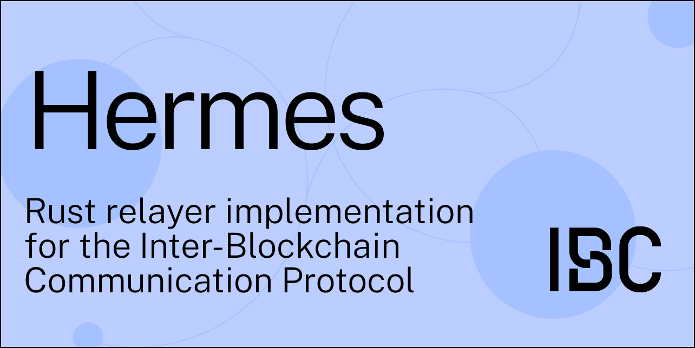

## Current Projects

- [polyfill-rs](https://github.com/jtranq/polyfill-rs) - A high-performance Rust client for Polymarket with 200+ stars

- [erdos-gyarfas-cubic-bipartite](https://github.com/jtranq/erdos-gyarfas-cubic-bipartite) - Companion repository for the paper proving a 60-vertex lower bound for cubic bipartite counterexamples to the Erdős–Gyárfás conjecture via exhaustive, certificate-backed computation. Guillaume Ducoffe and Bogdan Dumitru at the University of Bucharest cite this bound among the “best known results at the time of writing these lines” in their [study of the conjecture](https://arxiv.org/html/2609.28594v1#S1).

## Cardano Ecosystem Contributions

<h3 align="center"><a href="https://github.com/cardano-foundation/cardano-ibc-incubator">cardano-ibc-incubator</a></h3>

The Cardano Foundation’s implementation of IBC connectivity between Cardano and Cosmos.

 [500+ merged PRs](https://github.com/cardano-foundation/cardano-ibc-incubator/pulls?q=is%3Apr+is%3Amerged+author%3Ajtranq)

 

<h3 align="center"><a href="https://github.com/cardano-foundation/hermes-relayer">hermes-relayer</a></h3>

The Cardano Foundation’s fork of Hermes for relaying cross-chain messages between Cardano and Cosmos.

 [80+ merged PRs](https://github.com/cardano-foundation/hermes-relayer/pulls?q=is%3Apr+is%3Amerged+author%3Ajtranq)

 

<h3 align="center"><a href="https://github.com/IntersectMBO/cardano-ledger">cardano-ledger</a></h3>

The core implementation of Cardano’s ledger rules governing transaction validation, staking rewards and on-chain governance, written in Haskell.

 [#6071 · Execute Plutus scripts from sub-transactions and count their ExUnits](https://github.com/IntersectMBO/cardano-ledger/pull/6071) 
 [#6277 · Reject maximum pledge leverage updates below one](https://github.com/IntersectMBO/cardano-ledger/pull/6277) 
 [#6280 · Include Dijkstra subtransaction outputs in `producedTxOuts`](https://github.com/IntersectMBO/cardano-ledger/pull/6280) 

 

<h3 align="center"><a href="https://github.com/blinklabs-io/gouroboros">gOuroboros</a></h3>

The Go implementation of Cardano’s networking and consensus protocols, providing infrastructure for independent nodes and blockchain services.

 [#3088 · Release snapshots before stopping](https://github.com/blinklabs-io/gouroboros/pull/3088) 
 [#3055 · Share offset extraction across block decoders](https://github.com/blinklabs-io/gouroboros/pull/3055) 
 [#3053 · Correct rolling nonce derivation and combination](https://github.com/blinklabs-io/gouroboros/pull/3053) 
 [#3038 · Calculate DRep refunds from certificate amounts](https://github.com/blinklabs-io/gouroboros/pull/3038) 
 [#3036 · Reject invalid optional transaction body field types](https://github.com/blinklabs-io/gouroboros/pull/3036) 
 [#3034 · Restrict Conway VRF candidate switching to five slots](https://github.com/blinklabs-io/gouroboros/pull/3034) 
 [#3032 · Compare opcert issue numbers during Praos selection](https://github.com/blinklabs-io/gouroboros/pull/3032) 
 [#3030 · Validate block issuers against the leader snapshot](https://github.com/blinklabs-io/gouroboros/pull/3030) 
 [#3003 · Reject null required block collections](https://github.com/blinklabs-io/gouroboros/pull/3003) 
 [#3002 · Enforce era-specific transaction metadata label rules](https://github.com/blinklabs-io/gouroboros/pull/3002) 
 [#3001 · Accept duplicate pre-Conway withdrawal accounts](https://github.com/blinklabs-io/gouroboros/pull/3001) 
 [#2999 · Accept duplicate Babbage auxiliary-data indexes](https://github.com/blinklabs-io/gouroboros/pull/2999) 

 

<h3 align="center"><a href="https://github.com/bloxbean/yaci-store">Yaci Store</a></h3>

A Java framework for indexing Cardano blockchain data and making it available to applications through APIs.

 [#1417 · Save each transaction witness once](https://github.com/bloxbean/yaci-store/pull/1417) 
 [#1415 · Index collateral-return datums and reference scripts](https://github.com/bloxbean/yaci-store/pull/1415) 
 [#1413 · Require exact governance parent matching when no action is enacted](https://github.com/bloxbean/yaci-store/pull/1413) 
 [#1406 · Preserve epoch nonces across hard fork rollback](https://github.com/bloxbean/yaci-store/pull/1406) 
 [#1403 · Preserve governance state through ratification and enactment](https://github.com/bloxbean/yaci-store/pull/1403) 
 [#1401 · Fix native asset history pagination](https://github.com/bloxbean/yaci-store/pull/1401) 

 

<h3 align="center"><a href="https://github.com/aiken-lang/aiken">Aiken</a></h3>

The programming language and compiler for smart contract development on Cardano.

 [#1428 · Use byte offsets for EOF diagnostics](https://github.com/aiken-lang/aiken/pull/1428) 

 

<h3 align="center"><a href="https://github.com/Anastasia-Labs/lucid-evolution">Lucid Evolution</a></h3>

A community-developed TypeScript library for transaction construction and smart contract interaction on Cardano.

 [#734 · Upgrade evaluator and select ledger protocol](https://github.com/Anastasia-Labs/lucid-evolution/pull/734) 
